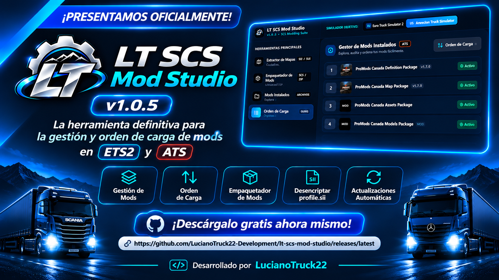

  
  <h1>🚛 LT SCS Mod Studio</h1>
  
<strong>La suite definitiva para creadores y jugadores de Euro Truck Simulator 2 y American Truck Simulator</strong>

  
  
  

---

## 🌟 ¿Qué es LT SCS Mod Studio?

**LT SCS Mod Studio** es una aplicación de escritorio diseñada para simplificar al máximo la gestión, empaquetado, orden de carga y auditoría de mods para **Euro Truck Simulator 2** y **American Truck Simulator**.

Desarrollada con tecnología nativa ultrarrápida (Tauri v2 + Rust), combina un motor de empaquetado SCS con una interfaz intuitiva para asegurar que tus sesiones de juego y convoyes funcionen sin crasheos ni incompatibilidades.

---

## ⚡ Características Principales

### 📦 1. Empaquetador Oficial de Mods (ZIP Universal & SCS HashFS)
- **Modo ZIP Universal:** Empaqueta en formato nativo con compresión inteligente **Store Nivel 0** para bancos de audio FMOD (`.bank`, `.guids`) y texturas (`.dds`, `.tobj`), garantizando máxima compatibilidad con el Mod Manager y el modo Convoy.
- **Modo SCS HashFS Oficial:** Integración directa con herramientas oficiales de SCS Software para crear Game Archives binarios (`SCS#`).
- **Editor visual de `manifest.sii`:** Configura título, versión, autores, categorías oficiales SCS, dependencias de DLC y descripción con formato de color en tiempo real.

### 📋 2. Gestor y Ordenador de Carga de Perfiles
- **Lectura directa de `profile.sii`:** Desencripta automáticamente tu perfil activo y te muestra los mods exactamente en el orden de prioridad del juego.
- **Soporte total de miniaturas e iconos:** Carga automática de los iconos de mods locales (`.scs`) y de Steam Workshop.
- **Detección inteligente:** Identifica mods faltantes, incompatibles o activos en Steam Cloud y perfiles locales.
- **Exportador de Infografías:** Genera imágenes y capturas limpias del orden de carga de tu perfil para compartir con amigos o comunidades VTC.

### 🔍 3. Auditor de Mods Instalados
- Escanea tu carpeta `/mod` y tu biblioteca de **Steam Workshop** de forma simultánea.
- Muestra el tamaño real, fecha de modificación, compatibilidad y formato interno de cada paquete.

### 🗺️ 4. Extractor de Mapas y Ciudades
- Extrae ciudades, coordenadas y empresas de mapas oficiales y mods de la comunidad (Promods, Reforma, etc.).

---

## Screenshot

  

---

## 📥 Descarga e Instalación

1. Dirígete a la sección de **[Últimos Lanzamientos (Releases)](https://github.com/LucianoTruck22-Development/lt-scs-mod-studio/releases/latest)**.
2. En la sección **Assets**, descarga el instalador:
   - `LT_SCS_Mod_Studio_x64_en-US.msi` o el ejecutable `.exe`.
3. Ejecuta el instalador y sigue las instrucciones en pantalla.

> [!NOTE]
> La aplicación cuenta con **sistema de auto-actualización automática**. Cuando se publique una nueva versión oficial, la aplicación te notificará y se actualizará automáticamente sin tener que volver a descargarla manualmente.

---

## 🛡️ Desarrollador y Soporte
- **Desarrollador Oficial:** LT Developer / LucianoTruck22 Development
- **Comunidad y Soporte:** Reporta errores o sugerencias en la pestaña [Issues](https://github.com/LucianoTruck22-Development/lt-scs-mod-studio/issues).

#
